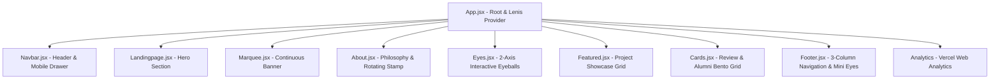

# 🏗️ Architecture & Lifecycle Management

This page documents the component hierarchy, rendering pipeline, and scroll synchronization across the OCHI Animation application.

---

## 🌳 Component Tree



---

## 🏎️ Lenis Smooth Scroll Pipeline

Smooth scrolling is powered by **[Lenis](https://github.com/darkroomengineering/lenis)**, initialized at the root level in [`App.jsx`](../src/App.jsx).

### Lifecycle & Cleanup

```javascript
useEffect(() => {
  const lenis = new Lenis({
    duration: 1.2,
    easing: (t) => Math.min(1, 1.001 - Math.pow(2, -10 * t)),
    orientation: "vertical",
    gestureOrientation: "vertical",
    smoothWheel: true,
    wheelMultiplier: 1.0,
    touchMultiplier: 1.5,
  });

  let animationFrameId;
  function raf(time) {
    lenis.raf(time);
    animationFrameId = requestAnimationFrame(raf);
  }

  animationFrameId = requestAnimationFrame(raf);

  return () => {
    cancelAnimationFrame(animationFrameId);
    lenis.destroy();
  };
}, []);
```

### Why Lenis Over Locomotive Scroll?

1. **Native Document Flow**: Lenis manipulates the native `window.scrollY` rather than intercepting the DOM with transformed wrapper `<div>` elements.
2. **Fixed Element Compatibility**: Position `fixed` elements (such as [`Navbar.jsx`](../src/componets/Navbar.jsx) and interactive dialogs) work without coordinate offset hacks.
3. **Memory Safety**: Clean disposal on component unmount with `cancelAnimationFrame` and `lenis.destroy()`.
